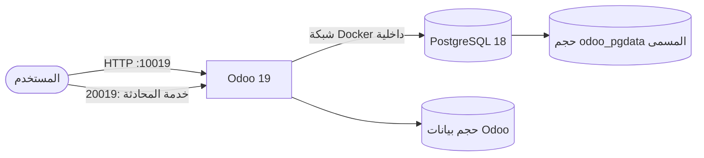
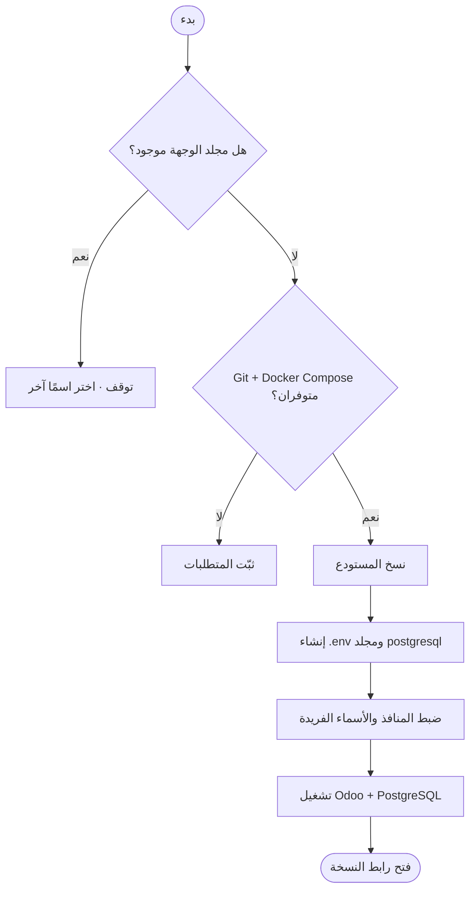
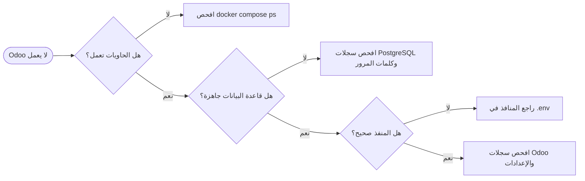

<div dir="rtl" align="right">

# دليل تثبيت Odoo 19 باستخدام Docker Compose

**Odoo 19 · PostgreSQL 18 · Docker Compose · دعم Traefik اختياري**

دليل عملي لتثبيت Odoo 19 وإدارته على Ubuntu/Linux، مع خيار تشغيل أكثر من
نسخة على الخادم نفسه.

[ابدأ التثبيت](#-التثبيت-السريع) · [تشغيل نسخ متعددة](#-تشغيل-أكثر-من-نسخة) ·
[إدارة الحاويات](#-إدارة-الحاويات) · [استكشاف الأخطاء](#-استكشاف-الأخطاء)

</div>

---

## 📑 المحتويات

1. [نظرة عامة](#-نظرة-عامة)
2. [المتطلبات](#-المتطلبات)
3. [معلومات الدخول والمنافذ](#-معلومات-الدخول-والمنافذ)
4. [التثبيت السريع](#-التثبيت-السريع)
5. [تشغيل أكثر من نسخة](#-تشغيل-أكثر-من-نسخة)
6. [الإعدادات](#️-الإعدادات)
7. [إدارة الحاويات](#-إدارة-الحاويات)
8. [النسخ الاحتياطي](#-النسخ-الاحتياطي)
9. [الصلاحيات وإعداد Linux](#️-الصلاحيات-وإعداد-linux)
10. [Traefik وHTTPS](#-traefik-وhttps-اختياري)
11. [استكشاف الأخطاء](#-استكشاف-الأخطاء)
12. [هيكل المشروع والأمان](#-هيكل-المشروع-والأمان)
13. [روابط مفيدة](#-روابط-مفيدة)

---

## 🔎 نظرة عامة

يشغّل المشروع Odoo 19 وقاعدة PostgreSQL 18 داخل حاويات Docker. تبقى قاعدة
البيانات على شبكة داخلية ولا يُنشر منفذها على الإنترنت.



| الخدمة | الصورة | منافذ المضيف الافتراضية | حفظ البيانات |
|---|---|---|---|
| Odoo | `odoo:19` | `10019` للويب، `20019` للمحادثة | حجم Docker باسم `odoo_data` |
| PostgreSQL | `postgres:18` | غير مكشوف للمضيف | حجم Docker باسم `odoo_pgdata` (PGDATA=/var/lib/postgresql/18/docker) |

---

## ✅ المتطلبات

- Ubuntu 22.04/24.04 أو توزيعة Linux مناسبة.
- Docker Engine.
- Docker Compose v2، ويُستخدم بالأمر `docker compose`.
- اتصال بالإنترنت عند تنزيل الصور أول مرة.
- توفر المنفذين `10019` و`20019`، أو اختيار منافذ بديلة.

تحقق من توفر الأدوات:

```bash
docker --version
docker compose version
docker run --rm hello-world
```

> على Windows، نفّذ الأوامر عبر WSL 2 بعد تفعيل تكامل Docker مع WSL.

---

## 🔐 معلومات الدخول والمنافذ

| البيان | القيمة الافتراضية | الاستخدام |
|---|---|---|
| كلمة مرور Odoo الرئيسية | `Admin@19` | إدارة قواعد البيانات من واجهة Odoo |
| مستخدم PostgreSQL | `odoo19` | اتصال Odoo بقاعدة البيانات |
| كلمة مرور PostgreSQL | `odoo@19` | اتصال Odoo بقاعدة البيانات |
| قاعدة PostgreSQL الابتدائية | `postgre` | قاعدة تُنشأ عند تهيئة PostgreSQL لأول مرة |
| واجهة Odoo | `http://localhost:10019` | استخدام النظام من المتصفح |
| منفذ المحادثة المباشرة | `http://localhost:20019` | خدمة المحادثة والاتصال المباشر |

> كلمة مرور Odoo الرئيسية ليست كلمة مرور حساب المستخدم الذي ستنشئه داخل
> قاعدة بيانات Odoo. غيّر كلمات المرور الافتراضية قبل إتاحة الخادم للإنترنت.

---

## 🚀 التثبيت السريع

### 1. تنزيل المشروع

```bash
git clone https://github.com/abdalazeim/InstallingOdoo19-Docker-Deployment.git
cd InstallingOdoo19-Docker-Deployment
```

يمكن أيضًا تنزيل المستودع كملف ZIP وفك ضغطه، ثم فتح الطرفية داخل مجلد المشروع.

### 2. إعداد ملف البيئة والصلاحيات

```bash
cp .env.example .env
chmod 600 .env
chmod +x entrypoint.sh
```

عدّل ملف `.env` وضع كلمات مرور قوية بدل القيم التجريبية قبل النشر العام.

### 3. تشغيل Odoo وPostgreSQL

```bash
docker compose pull
docker compose up -d
docker compose ps
```

افتح Odoo:

| الخدمة | الرابط |
|---|---|
| واجهة Odoo | [http://localhost:10019](http://localhost:10019) |
| منفذ المحادثة المباشرة | [http://localhost:20019](http://localhost:20019) |

> منفذ `20019` مخصص لخدمة المحادثة/الاتصال المباشر، وليس واجهة ويب مستقلة.

---

## 🧩 تشغيل أكثر من نسخة

ينسخ السكربت `run.sh` المستودع إلى **مجلد جديد**، ويضبط منافذ وأسماء حاويات
وشبكة خاصة بكل نسخة. لن يستبدل مجلدًا موجودًا.



**المتطلبات:** Git وDocker وDocker Compose v2 وصلاحية تشغيل Docker.

نفّذ الأوامر من جذر المستودع:

```bash
# النسخة الأولى
sudo bash run.sh --destination odoo-live --port 10019 --chat 20019

# النسخة الثانية
sudo bash run.sh --destination odoo-test --port 11019 --chat 21019
```

| النسخة | المجلد | رابط Odoo | منفذ المحادثة |
|---|---|---|---|
| `odoo-live` | `odoo-live/` | [http://localhost:10019](http://localhost:10019) | `20019` |
| `odoo-test` | `odoo-test/` | [http://localhost:11019](http://localhost:11019) | `21019` |

لإدارة نسخة محددة، انتقل إلى مجلدها:

```bash
cd odoo-live
docker compose ps
docker compose logs -f
```

---

## ⚙️ الإعدادات

عدّل `.env` ولا تضفه إلى Git. الملف مستثنى بالفعل في `.gitignore`.

| المتغير | القيمة الافتراضية | الوظيفة |
|---|---|---|
| `ODOO_IMAGE` | `odoo:19` | صورة Odoo |
| `PG_IMAGE` | `postgres:18` | صورة PostgreSQL |
| `POSTGRES_USER` | `odoo19` | مستخدم قاعدة البيانات |
| `POSTGRES_PASSWORD` | `odoo@19` (غيّره فورًا) | كلمة مرور قاعدة البيانات |
| `POSTGRES_DB` | `postgre` | قاعدة تُنشأ عند تهيئة PostgreSQL لأول مرة |
| `ODOO_ADMIN_PASSWORD` | `Admin@19` | كلمة مرور Odoo الرئيسية |
| `ODOO_HTTP_PORT` | `10019` | منفذ المضيف لـ Odoo |
| `ODOO_CHAT_PORT` | `20019` | منفذ المضيف للمحادثة |
| `ODOO_DOMAIN` | مطلوب مع Traefik | اسم النطاق |
| `DOCKER_PROXY_NETWORK` | `proxy` | شبكة Traefik الخارجية |

### إدارة قاعدة البيانات (`ODOO_DB_NAME`)

| المتغير | القيمة الافتراضية | الوظيفة |
|---|---|---|
| `ODOO_DB_NAME` | *(فارغ)* | **فارغ = محدد قواعد البيانات مفعل** (تظهر جميع قواعد البيانات). اضبط اسماً (مثلاً `myapp`) لقفل Odoo على قاعدة واحدة. |
| `ODOO_AUTO_INIT` | `1` | إنشاء قاعدة تلقائياً عند أول تشغيل إذا كان `ODOO_DB_NAME` مضبوطاً والقاعدة غير موجودة. |

**هام:** ملف `.env.example` الافتراضي يحتوي على `ODOO_DB_NAME=` (فارغ). هذا يفعّل مدير قواعد البيانات في `/web/database/manager` لعرض جميع القواعد. لقفل النظام على قاعدة واحدة، اضبط `ODOO_DB_NAME=اسم_قاعدتك` في `.env` قبل أول تشغيل.

مثال: قفل على قاعدة `myapp`:
```dotenv
ODOO_DB_NAME=myapp
```

طبّق التغييرات:
```bash
docker compose up -d
```

> **قاعدة بيانات موجودة:** متغيرات تهيئة PostgreSQL تُطبَّق عند أول تهيئة
> لمجلد البيانات فقط. تغيير كلمات المرور في `.env` لا يغيّر بيانات PostgreSQL
> الموجودة. لإعادة التعيين، أوقف الحاويات واحذف حجم `odoo_pgdata` (`docker compose down -v`).

الإضافات المخصصة توضع في `addons/`. إعداد Odoo الأساسي موجود في
`etc/odoo.conf`، بينما تُحقن الأسرار وقت التشغيل من البيئة.

## المشاكل الشائعة والحلول

| المشكلة | السبب | الحل |
|---|---|---|
| `database 'X' already exists` عند الإنشاء | قاعدة منشأة مسبقاً (auto-init أو يدوياً) | احذف القاعدة: `docker exec -it <db-container> psql -U <user> -d postgres -c "DROP DATABASE X;"` (أوقف Odoo أولاً) |
| "Logged into database 'X', but dbfilter rejects it" | `list_db = False` + `db_name` مقفلة على قاعدة واحدة | اضبط `list_db = True` في `etc/odoo.conf`، اترك `db_name` معلّقاً |
| "database is being accessed by other users" عند الحذف | Odoo متصل بالقاعدة | أوقف حاوية Odoo أولاً: `docker compose stop odoo19` |
| خطأ mount في PostgreSQL 18+ | mount المسار `/var/lib/postgresql/data` غير مدعوم | استخدم حجم مسمى مع `PGDATA=/var/lib/postgresql/18/docker` (مُصلح مسبقاً) |
| Odoo لا يتصل بـ PostgreSQL | قاعدة البيانات غير جاهزة عند بدء Odoo | Healthcheck + `depends_on: condition: service_healthy` (مُصلح مسبقاً) |

---

## 🧰 إدارة الحاويات

نفّذ الأوامر من مجلد النشر:

| العملية | الأمر |
|---|---|
| تشغيل | `docker compose up -d` |
| حالة الحاويات | `docker compose ps` |
| سجلات كل الخدمات | `docker compose logs -f` |
| سجلات Odoo | `docker compose logs -f odoo19` |
| سجلات PostgreSQL | `docker compose logs -f db` |
| إعادة تشغيل | `docker compose restart` |
| إيقاف مع إبقاء الحاويات والبيانات | `docker compose stop` |
| إيقاف مع الحفاظ على البيانات | `docker compose down` |

الخدمتان تستخدمان `restart: always`. يحفظ `docker compose down` البيانات.
تجنب `docker compose down -v` إلا إذا كنت تريد حذف حجم بيانات Odoo. لا تحذف
حجم `odoo_pgdata` إلا إذا كنت تريد حذف بيانات قاعدة البيانات.

---

## 💾 النسخ الاحتياطي

البيانات محفوظة في حجم `odoo_pgdata` المسمى لـ PostgreSQL وحجم `odoo_data` المسمى لـ Odoo. نفّذ
الأوامر التالية من مجلد النسخة الافتراضية؛ إذا أنشأت النسخة عبر `run.sh`
فاستخدم أسماء الحاويات التي تظهرها `docker compose ps`.

```bash
mkdir -p backups
docker exec odoo19-db pg_dumpall -U odoo19 > backups/postgresql-all.sql
docker exec odoo19 tar -C /var/lib/odoo -czf /tmp/odoo-data.tar.gz .
docker cp odoo19:/tmp/odoo-data.tar.gz backups/odoo-data.tar.gz
docker exec odoo19 rm -f /tmp/odoo-data.tar.gz
```

احمِ ملفات النسخ الاحتياطي، واحتفظ بنسخة إضافية خارج الخادم، واختبر
الاستعادة دوريًا.

---

## 🔒 الصلاحيات وإعداد Linux

### الصلاحيات

لا تستخدم `chmod -R 777`؛ فهو يمنح صلاحيات كاملة لكل مستخدم على النظام. استخدم
صلاحيات محدودة:

```bash
chmod 600 .env
chmod +x entrypoint.sh
```

الأحجام المسماة (`odoo_data`، `odoo_pgdata`) تديرها Docker ولا تتطلب ضبط
صلاحيات على المضيف.

### اختياري · رفع حد inotify

قد يفيد هذا الإعداد عند تشغيل عدة نسخ ويظهر حد مراقبة الملفات في Linux:

```bash
if grep -qF "fs.inotify.max_user_watches" /etc/sysctl.conf; then
  grep -F "fs.inotify.max_user_watches" /etc/sysctl.conf
else
  echo "fs.inotify.max_user_watches = 524288" | sudo tee -a /etc/sysctl.conf
fi

sudo sysctl -p
```

---

## 🌐 Traefik وHTTPS (اختياري)

استخدم [`docker-compose.traefik.yml`](docker-compose.traefik.yml) فقط إذا كان
Traefik يعمل بالفعل والشبكة الخارجية موجودة.

```dotenv
ODOO_DOMAIN=odoo.example.com
DOCKER_PROXY_NETWORK=proxy
CERTSRESOLVER=letsencrypt
```

```bash
docker network create proxy   # إذا لم تكن الشبكة موجودة
docker compose -f docker-compose.traefik.yml up -d
```

اضبط DNS وإعدادات Traefik على الخادم، ثم افتح `https://odoo.example.com`. لا
تشغّل وضع المنافذ المباشرة ووضع Traefik للنسخة نفسها في الوقت نفسه.

---

## 🩺 استكشاف الأخطاء

| المشكلة | الإجراء |
|---|---|
| المنفذ مستخدم | غيّر `ODOO_HTTP_PORT` أو `ODOO_CHAT_PORT` في `.env` ثم نفّذ `docker compose up -d` |
| Odoo لا يتصل بقاعدة البيانات | راجع `docker compose logs db odoo19` |
| فحص جاهزية PostgreSQL | نفّذ `docker compose exec db pg_isready -U odoo19 -d postgre` |
| خطأ في إعداد Odoo | راجع `docker compose logs --tail=100 odoo19` |
| كلمات المرور تغيّرت دون أثر | بيانات PostgreSQL الحالية لا تُعاد تهيئتها من `.env` |
| Traefik لا يوجّه الطلب | تحقق من DNS والشبكة الخارجية و`ODOO_DOMAIN` |



---

## 🗂️ هيكل المشروع والأمان

```text
InstallingOdoo19-Docker-Deployment/
├── addons/                       # الإضافات المخصصة
├── etc/
│   ├── odoo.conf                 # قالب إعداد Odoo
│   └── requirements.txt          # حزم Python اختيارية
├── .env.example                  # قالب متغيرات البيئة
├── docker-compose.yml            # نشر مباشر عبر منافذ المضيف
├── docker-compose.traefik.yml    # نشر اختياري عبر Traefik
├── entrypoint.sh                 # تهيئة الإعداد وانتظار PostgreSQL وتهيئة قاعدة البيانات
├── run.sh                        # تثبيت اختياري لنسخ متعددة
└── README.md
```

**الأحجام (غير ملتزمة):**
- `odoo_data` — ملفات Odoo/المرفقات (حجم مسمى)
- `odoo_pgdata` — بيانات PostgreSQL (حجم مسمى، PGDATA=/var/lib/postgresql/18/docker)

**قائمة أمان سريعة:**

- غيّر كلمات مرور Odoo وPostgreSQL الافتراضية.
- لا ترفع `.env` أو بيانات قواعد البيانات أو النسخ الاحتياطية إلى Git.
- لا تنشر منفذ PostgreSQL.
- استخدم HTTPS عبر وكيل عكسي موثوق عند النشر العام.
- حدّث صور Docker وخادم المضيف بانتظام.

---

## 🔗 روابط مفيدة

- [توثيق Odoo 19](https://www.odoo.com/documentation/19.0/)
- [توثيق Docker Compose](https://docs.docker.com/compose/)
- [مستودع GitHub](https://github.com/abdalazeim/InstallingOdoo19-Docker-Deployment)
- [الإبلاغ عن مشكلة](https://github.com/abdalazeim/InstallingOdoo19-Docker-Deployment/issues)

<div dir="rtl" align="right">

Odoo 19 · PostgreSQL 18 · Docker Compose · Ubuntu/Linux · Traefik (اختياري)

</div>
